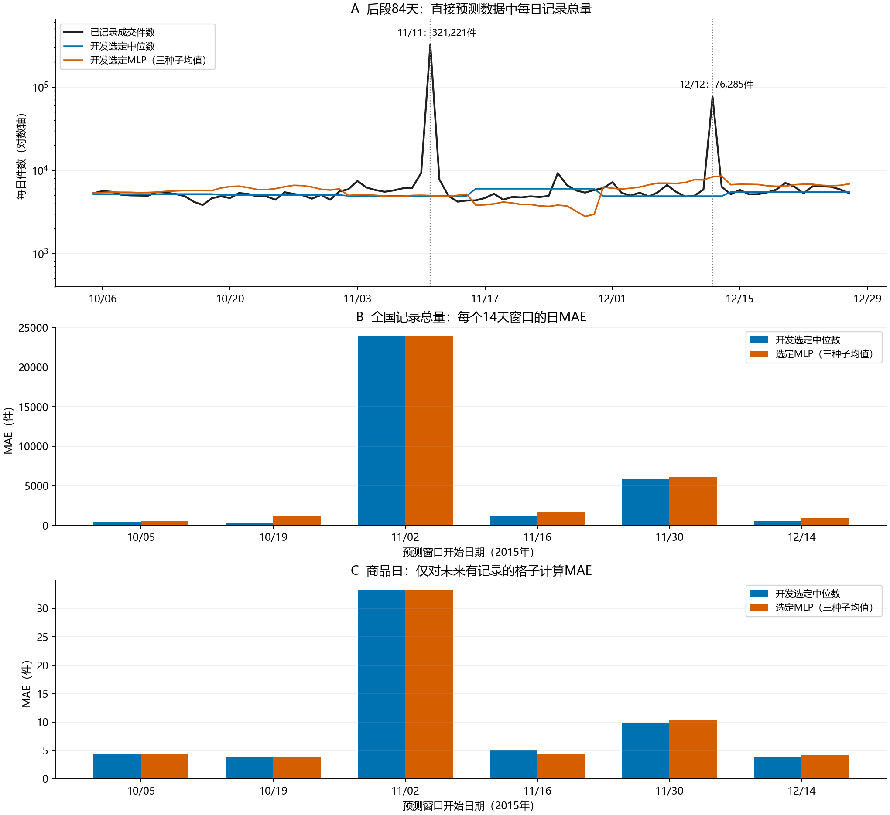

# 智能分仓数据：深度学习与中位数对照

**本轮没有稳定超过中位数。** 全国记录总量与商品日两个任务中，开发选中的MLP在后段总体误差均高于开发选中的近14日中位数；三个单独种子的总体误差也均更高。

预测目标是`qty_alipay`（成交件数），每次预测未来14天。全国任务直接预测每日已记录成交件数之和；商品任务使用多个商品共同训练一个MLP，仅对未来有记录的商品日计算误差。两者分别训练，商品预测没有按未来记录掩码求和来冒充全国预测。

| 评价对象 | 中位数日MAE | 选中MLP日MAE | 相对误差变化 | 胜出窗口 | 稳定超过 |
| --- | ---: | ---: | ---: | ---: | --- |
| 全国记录总量 | 5,346.6310 | 5,736.1010 | +7.28% | 1/6 | 否 |
| 商品日 | 10.0030 | 10.0495 | +0.47% | 2/6 | 否 |

MAE表示平均每个有真值的日期／商品日错多少件，越小越好。全国与商品行的统计单位不同，数值不能互相比大小。“稳定”预先定义为后段总体更好、六窗均不退步，且三个种子的总体MAE各自更好；本轮不满足。



## 数据与特征

完整库包含232,621个商品日、1,000个商品、453个日期，覆盖2014-10-01—2015-12-27。商品记录数量与日期覆盖不同；只有99个商品全程都有记录。缺记录保持未知，真实记录里的0仍是0；商品预测资格只看起点之前56天是否至少有28次观测。详见[完整数据审计](data_audit.md)。

基础输入为近28天成交量、观测掩码、7/14/28/56天统计和未来已知日历。行为版本另加历史浏览人数、加购人数、收藏人数、下单件数及支付笔数的7/28天统计。它们全部截至预测起点；没有使用未来真实浏览、支付、下单值。商品模型还使用类目，输入处理只由当前训练集拟合。

固定日历包含星期、年内周期及11月11日／12月12日。预测2015年的相应日期时，仅有一次上一年的相应日期，多个商品不是多个独立促销年份；共享模型仍未在本次对照中解决这种跨年高峰。Cost表虽包含仓代码，但成交表没有可关联的区域／仓字段，因此本轮不称为已完成分仓预测。

## 开发期的删减对照

先用2015-07-13—10-04的六个非重叠14天窗口比较三个预设MLP，每个候选只用种子20261023。选型按总体有真值格子的MAE进行，并分别在14/28/56日中位数中选主基线。开发最优MLP本身也未超过中位数；“选中”仅表示三个深度候选中最好。

| 方法 | 全国开发MAE | 商品日开发MAE |
| --- | ---: | ---: |
| 近14日中位数 | 666.4048 | 4.0673 |
| 近28日中位数 | 709.9762 | 4.2386 |
| 近56日中位数 | 675.9167 | 4.5820 |
| 近28日均值 | 868.2721 | 4.9560 |
| 近8周同星期均值 | 1,024.0655 | 5.8759 |
| Ridge（含历史行为） | 1,502.9551 | 9.0886 |
| MLP：成交历史＋MAE | 937.0086 | 4.2676 |
| MLP：增加历史行为＋MAE | 964.2151 | 4.2291 |
| MLP：增加历史行为＋Poisson | 2,093.6477 | 5.4057 |

全国选中`mlp_sales_mae`，商品选中`mlp_behavior_mae`；两者主中位数均为`median14`。增加历史行为仅在商品开发对照中略降MAE；Poisson损失在两个任务中都更差。行为和损失候选没有在后段重新筛选。

## 后段全部基线与种子

后段为2015-10-05—12-27的六个非重叠14天窗口。每次仅使用当时已经结束的训练目标；后来的窗口可使用早先窗口已经发生的记录，符合滚动更新场景。测试只训练开发选中的深度候选，固定取三个种子的算术均值。

| 方法 | 全国日MAE | 商品日MAE | 全国14天总量平均绝对误差 |
| --- | ---: | ---: | ---: |
| 近14日中位数 | 5,346.6310 | 10.0030 | 71,618.50 |
| 近28日中位数 | 5,278.8214 | 9.8953 | 69,542.83 |
| 近56日中位数 | 5,358.2857 | 10.1126 | 72,373.00 |
| 近28日均值 | 8,815.0094 | 14.6344 | 101,776.50 |
| 近8周同星期均值 | 8,232.0387 | 14.6262 | 85,829.75 |
| Ridge（含历史行为） | 7,623.8487 | 15.5812 | 76,235.73 |
| 各自选定MLP：三种子均值 | 5,736.1010 | 10.0495 | 73,789.80 |
| 各自选定MLP：种子20261023 | 5,841.6820 | 10.2231 | 76,368.62 |
| 各自选定MLP：种子20261024 | 5,877.2351 | 10.2304 | 69,423.42 |
| 各自选定MLP：种子20261025 | 5,708.1334 | 10.1198 | 75,577.35 |

近28日中位数后段数值也保留作敏感性对照，主结论继续使用开发选定的近14日中位数，没有根据后段重选基线。Ridge始终使用含历史行为的特征，全国选中的MLP只用成交历史；两者差异不能单独归因于线性／非线性模型。

## 六个窗口分别发生了什么

### 全国记录总量

| 窗口开始 | 中位数MAE | MLP均值MAE | MLP增加的误差 |
| --- | ---: | ---: | ---: |
| 2015-10-05 | 382.2857 | 570.7494 | +188.4637 |
| 2015-10-19 | 304.6429 | 1,207.5594 | +902.9166 |
| 2015-11-02 | 23,865.6429 | 23,861.4491 | -4.1937 |
| 2015-11-16 | 1,160.1429 | 1,713.4989 | +553.3560 |
| 2015-11-30 | 5,820.1429 | 6,144.9573 | +324.8144 |
| 2015-12-14 | 546.9286 | 918.3920 | +371.4634 |

### 商品日

| 窗口开始 | 中位数MAE | MLP均值MAE | MLP增加的误差 |
| --- | ---: | ---: | ---: |
| 2015-10-05 | 4.2716 | 4.3382 | +0.0666 |
| 2015-10-19 | 3.9067 | 3.8863 | -0.0204 |
| 2015-11-02 | 33.1928 | 33.2004 | +0.0075 |
| 2015-11-16 | 5.1044 | 4.3955 | -0.7089 |
| 2015-11-30 | 9.7457 | 10.3399 | +0.5942 |
| 2015-12-14 | 3.9009 | 4.1535 | +0.2525 |

## 普通日期与固定活动日期

以下只按事先固定的11/11、12/12区分日期，不按实际成交峰值挑日期，也不据此切换模型。“过估／低估”分别是每个评分格子正向／负向误差的平均件数，包含另一个方向为0的格子；二者之和等于MAE。

| 对象／日期 | 评分格子 | 中位数MAE | MLP MAE | 中位数过估／低估 | MLP过估／低估 |
| --- | ---: | ---: | ---: | ---: | ---: |
| 全国／其余日期 | 82 | 749.2683 | 1,190.8264 | 266.1951／483.0732 | 676.6428／514.1836 |
| 全国／11/11 | 1 | 316,285.0000 | 316,247.9634 | 0.0000／316,285.0000 | 0.0000／316,247.9634 |
| 全国／12/12 | 1 | 71,392.0000 | 67,936.7588 | 0.0000／71,392.0000 | 0.0000／67,936.7588 |
| 商品日／其余日期 | 57,882 | 4.3867 | 4.4160 | 1.5548／2.8319 | 1.5714／2.8446 |
| 商品日／11/11 | 711 | 387.1892 | 387.2237 | 0.0359／387.1533 | 0.0317／387.1920 |
| 商品日／12/12 | 809 | 80.3344 | 81.6288 | 0.1094／80.2250 | 0.0761／81.5526 |

全国其余82天的MAE从749.27升至1,190.83，平均过估从266.20升至676.64件；活动日的少量误差下降没有抵消日常退步。商品日其余日期的MAE也从4.3867升至4.4160，因此不能把失败全部归因于两个活动日。

## 商品评分覆盖

所有达到历史条件的商品都输出14天预测；评分时只取未来有记录的格子。这个条件是为了不把未知真值当零，覆盖范围必须随误差一起读。

| 窗口开始 | 有资格商品 | 评分格子／全部记录格子 | 记录格子覆盖 | 成交件数覆盖 |
| --- | ---: | ---: | ---: | ---: |
| 2015-10-05 | 652 | 8,447／10,017 | 84.33% | 93.03% |
| 2015-10-19 | 680 | 8,958／10,805 | 82.91% | 93.23% |
| 2015-11-02 | 719 | 9,689／11,936 | 81.17% | 88.59% |
| 2015-11-16 | 765 | 9,942／11,784 | 84.37% | 94.22% |
| 2015-11-30 | 830 | 10,867／12,340 | 88.06% | 92.10% |
| 2015-12-14 | 880 | 11,499／12,515 | 91.88% | 96.69% |

合计评分59,402个商品日，占后段全部已记录商品日的85.60%，覆盖已记录成交件数的91.24%。这些数量从原库只读重算，与保存的目标掩码核对一致。

## 解释与下一步

这次增加了商品共享训练和历史行为输入，结果仍支持保留中位数作简易参考。全国模型普通日期误差与高峰误差需分别检查；商品模型的小幅局部改善不足以形成跨窗口优势。后续如继续修改，应先针对这些已暴露的错误提出有限对照，不能把增加网络宽度或更换架构直接写成改善。

全量数据审计已经查看日期、覆盖及目标极值；后段属于配置冻结后的历史评价，不是前瞻盲测。六个窗口不重叠，但只有六段，三个种子也不是三份新数据。本结果不能证明未来持续有效，也不评价库存成本或真实分仓收益。其他来源与适用范围集中见[证据说明](../../../docs/research/evidence.md)。

## 实际运行与复现

本轮实际完成72次MLP拟合，训练主流程耗时123.89秒。CPU单线程PyTorch 2.14.0+cpu；Python 3.12.10，NumPy 2.3.5，pandas 2.3.3。全国网络32/16隐藏单元、120轮；商品网络64/32、25轮。完整参数、训练日志和预测在运行目录中。

在仓库根目录使用已安装PyTorch的系统Python运行；本机`.venv`没有PyTorch。新复现请换输出目录：

```powershell
python research/smart-demand/audit.py
python research/smart-demand/run.py --output outputs/smart-demand-reproduce
python research/smart-demand/verify.py --output outputs/smart-demand-reproduce
python research/smart-demand/report.py --output outputs/smart-demand-reproduce --results research/smart-demand/results-reproduce
python -m unittest discover -s research/smart-demand -p "test_*.py" -v
```

本页数字见[summary.json](summary.json)，84天全国逐日预测见[national_daily_predictions.csv](national_daily_predictions.csv)。商品完整预测仍保存在运行目录的`predictions/sku/`，不展开复制大明细。

## 已完成的验证

独立重算状态为`success`：检查264个预测／真值数组，从原SQLite重算120份基线，并核对48份种子平均预测及开发选择。相关验证见运行目录`verification.json`。模型与数据共20项测试通过；主仓78项测试通过。完整教学练习在源文件副本重跑通过，执行清单位于`outputs/smart-demand-20261023/exercise-check/examples/results/run_manifest.json`。
